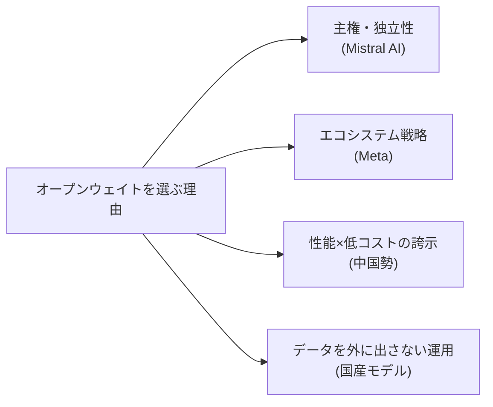

# 057 オープンウェイト陣営（Meta/Mistral/中国勢）と日本語モデル

!!! abstract "この記事で説明できるようになること"
    - 「オープンウェイト」が何を指し、クローズドAPI提供との違いが実務に何をもたらすかを説明できる
    - Meta・Mistral AI・中国勢（DeepSeek/Qwen/GLM/Moonshot AI）がオープンウェイトを選ぶ狙いの違いを比較できる
    - 日本語モデル（国産オープン・国産クローズド）の立ち位置を、トークナイザー性能という具体的な軸で説明できる

## 仕組み

「オープンウェイト」とは、学習済みモデルのパラメータ（重み）そのものを公開し、誰でもダウンロードして自分の環境で動かせるようにする公開方式を指す。OpenAI・Anthropic・Googleの主力モデルは基本的に自社サーバー上でのAPI提供（クローズド）だが、以下の陣営はオープンウェイトを軸に据えている。

- **Mistral AI（フランス）**：2026年9月に30億ユーロを調達し評価額210億ユーロ超。「主権AI（sovereign AI）」——データ処理の地域性とモデル選択の自由度——を訴求点に、Mistral Large / Ministral / Mistral OCRなどをApache 2.0で公開している
- **中国勢（DeepSeek・Qwen・GLM・Moonshot AI）**：オープンウェイトかつ低価格で欧米フロンティアモデルに迫る性能を示すのが共通パターン。例えばMoonshot AIの「Kimi K3」はコーディング評価SWE-bench Verifiedで上位モデルに1.2ポイント差まで迫りつつ、コストはClaude Opus 4.8の約半分とされる。一方で米NSA・CISA・FBIは、こうした企業が米国製フロンティアモデルから「知識蒸留」で機能を抽出していると警告しており、性能競争と知的財産論争が同時に進む
- **Meta**：2026年10月に初の大型「フロンティアモデル」Muse Wonderを公開しつつ、軽量モデル「Muse Glimmer」などもオープンウェイトで提供し、開発者のエコシステムを広く取り込む戦略をとる

日本語モデルは、この「オープンウェイト」と「クローズドAPI」の両方の形で存在する。KDDI傘下のELYZAは国立情報学研究所（NII）公開の「LLM-jp-4」をベースにした日本語強化モデルをApache 2.0で無料公開（オープンウェイト）する一方、ソフトバンク子会社SB Intuitionsは2026年10月13日、日本語モデル「Sarashina」をチャット＋API提供のクローズド方式（無償β版）で一般開放した。SB Intuitionsは、日本語向けに設計したトークナイザにより同じ文章を米国モデルの半分のトークン数で表せると説明している（出典: [ITmedia NEWS](https://www.itmedia.co.jp/news/article/2610/13/2000002224/)、取得日2026-10-13）。トークン数が半分になれば、同じ処理内容でも課金対象のトークン数が減りコストに直結するため、日本語モデルの価値は「精度」だけでなくこの「トークン効率」でも測る必要がある（学習002「トークナイザー」参照）。

## 比較・判断基準

| 陣営 | 公開方式 | 強み | 向き不向き |
|---|---|---|---|
| Mistral AI | オープンウェイト | 地域内データ処理・ベンダー非依存 | 自社ホスト運用の体制が必要 |
| 中国勢（Qwen/DeepSeek/GLM/Kimi） | オープンウェイト | 性能/価格比が高い | 知的財産・データの扱いに関する論争に留意 |
| Meta | 一部オープンウェイト | エコシステムの広さ | 自社ベンチマークのみで第三者検証が乏しい場合がある |
| 国産オープン（ELYZA等） | オープンウェイト | データを外に出さない運用・ライセンスの明確さ | 自社ホスト前提でインフラ投資が必要 |
| 国産クローズド（Sarashina等） | クローズドAPI | 日本語トークン効率・導入の手軽さ | 無償β版は提供継続性が未定 |

## 落とし穴

1. 「オープンウェイトだから安全・安心」と早合点しない——安全策の回避率が高いモデルも存在し、性能の高さと安全マージンの薄さは別の軸で評価する必要がある
2. 自社ベンチマークのみの性能比較を鵜呑みにしない——第三者検証の有無を必ず確認する（学習040参照）
3. 「日本語に強い」の中身を確認する——トークナイザーの効率（コスト）と、応答の精度・自然さは別の指標であり、両方を見ないと導入判断を誤る

## 実務への接続

データを外部に出したくない企業・自社ホスト運用を検討する企業にとって、オープンウェイトモデル（国内外問わず）は選択肢の一つになる。一方、まず無料で試して業務適性を見極めたい場合は、Sarashinaのような無償β版のクローズドAPIが入口として使いやすい。どちらを選ぶにしても、「重みが公開されているか」と「無料で使えるか」は別の軸であることを押さえておくと、ベンダー選定の議論が噛み合いやすくなる。

## 講座で使うなら
- 30 秒説明: 「AIモデルには『無料で使える』と『中身（重み）が公開されている』という2つの別々の軸があります。今日はその軸で各社・各国の戦略を整理します」
- たとえ話: レシピを公開している店（オープンウェイト）と、店は非公開だが出前は誰でも安く頼める店（クローズドだが無償提供）の違い
- 演習案: 受講者が知っているAIツールを「オープンウェイトか」「無料か」の2軸でマッピングさせ、分布の偏りから業界の力学を議論させる

## 出典・参考
- [ITmedia NEWS — 国産AI「Sarashina」が無料で試せるWebサイト、ソフトバンク子会社が公開　6つのAIモデルが呼び出せるAPIも](https://www.itmedia.co.jp/news/article/2610/13/2000002224/)（取得日 2026-10-13）
- [topics/mistral-ai](../../topics/mistral-ai.md)、[topics/moonshot-ai](../../topics/moonshot-ai.md)、[topics/qwen](../../topics/qwen.md)、[topics/deepseek](../../topics/deepseek.md)、[topics/glm](../../topics/glm.md)、[topics/elyza](../../topics/elyza.md) の既存記述（各ページの出典を参照）

## 関連
- [topics/sb-intuitions](../../topics/sb-intuitions.md)
- [learn/intermediate/002-tokenizer-japanese-cost](002-tokenizer-japanese-cost.md)
- [learn/intermediate/012-open-weight-vs-closed](012-open-weight-vs-closed.md)
